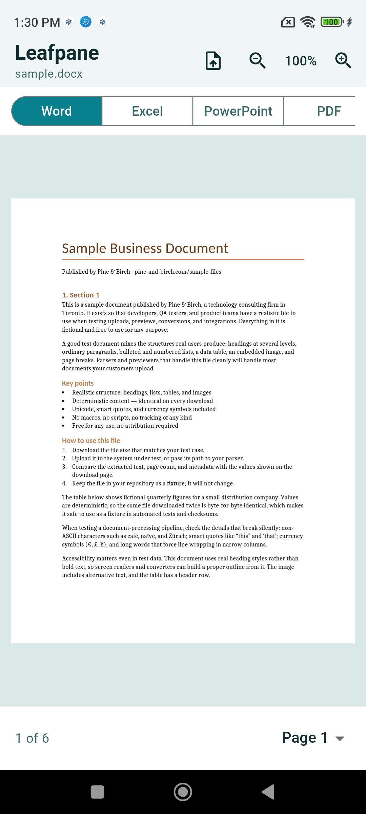
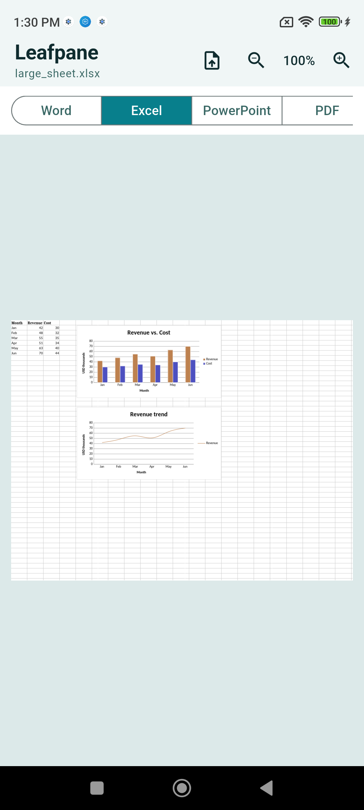
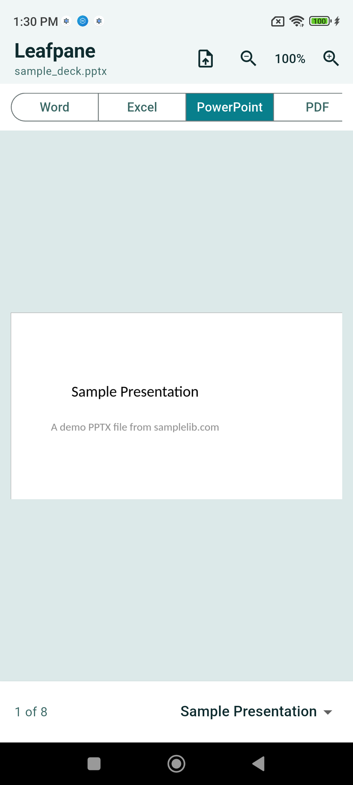
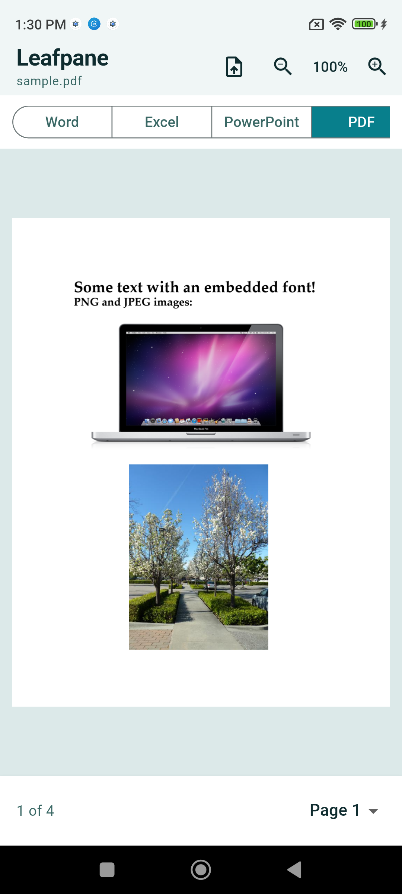

A Flutter package to view **PDF** (and, in the example app, Office) documents on Android and iOS.

> [!IMPORTANT]
> PDF viewing works on pub.dev today via [`office_viewer_engine_pdf`](https://pub.dev/packages/office_viewer_engine_pdf). Word, Excel, and PowerPoint use the in-repo [`office_viewer_engine_dart`](packages/office_viewer_engine_dart) engine in [`example_app/`](example_app/) and are **not** published on pub.dev yet.

<p align="center">
  
  
  
  
</p>

<p align="center">
  <sub>Example app with the Dart OOXML engine (Android). Only PDF is available from pub.dev today.</sub>
</p>

## Features

- Fit-width zoom with pinch / double-tap and pan clamp
- Part switching (pages, sheets, slides)
- Soft-fail on corrupt or password-protected docs (`OpenOptions(password:)`)
- Pluggable engines via `OfficeEngineRegistry` (first match wins)
- PDF on pub.dev today via [`office_viewer_engine_pdf`](https://pub.dev/packages/office_viewer_engine_pdf) (pdfrx / PDFium)
- DOCX / XLSX / PPTX in the example via [`office_viewer_engine_dart`](packages/office_viewer_engine_dart) (pure Dart OOXML)

## Requirements

Required for the recommended install (`office_viewer` + `office_viewer_engine_pdf`):

| | |
|---|---|
| Flutter | `>=3.47.0` |
| Dart | `>=3.12.0 <4.0.0` |
| Platforms | **Android** and **iOS** only |
| Android `minSdk` | Flutter default (`flutter.minSdkVersion`, typically 21+) |
| iOS deployment target | **15.0+** (see `example_app/`) |

## Support

### On pub.dev

Install [`office_viewer`](https://pub.dev/packages/office_viewer) + [`office_viewer_engine_pdf`](https://pub.dev/packages/office_viewer_engine_pdf).

| | Android | iOS |
|---|:---:|:---:|
| **PDF** | ✓ | ✓ |
| **Word (DOCX)** | ✗ | ✗ |
| **Excel (XLSX)** | ✗ | ✗ |
| **PowerPoint (PPTX)** | ✗ | ✗ |
| **Pan / zoom / fit-width** | ✓ | ✓ |
| **Password-protected files** | ✓ | ✓ |

### In the example app (Dart OOXML engine)

The screenshots above use our example host. PDF uses the pub PDF engine; Word / Excel / PowerPoint use [`office_viewer_engine_dart`](packages/office_viewer_engine_dart) (path dependency in [`example_app/`](example_app/)).

| | Android | iOS |
|---|:---:|:---:|
| **PDF** | ✓ | ✓ |
| **Word (DOCX)** | ✓ | ✓ |
| **Excel (XLSX)** | ✓ | ✓ |
| **PowerPoint (PPTX)** | ✓ | ✓ |
| **Pan / zoom / fit-width** | ✓ | ✓ |
| **Password-protected OOXML** | soft-fail | soft-fail |

Password-protected OOXML files surface `PasswordRequiredError` (no decrypt in the Dart engine yet). PDF passwords work via the PDF engine.

### Limitations

- **Mobile only for now.** Web, Windows, macOS, and Linux are not available yet.
- **Word, Excel, and PowerPoint are not on pub.dev yet.** The Dart OOXML engine lives in-repo and powers [`example_app/`](example_app/); pub publish for that package is still upcoming.
- **Other file types** (older DOC / XLS / PPT, OpenDocument ODT / ODS / ODP, CSV / TXT) are not supported by the Dart engine.
- **Viewing only.** Edit, search, print, and annotations are out of scope — your app owns chrome and those workflows.
- **You open the file.** Pass bytes or a local path after your own download / picker; cloud open is not built into the package.
- **Large sheets.** Huge workbooks can pressure mid-range phones; we clamp sheet extent and cull tiles — still tune heap use for extreme cases.
- **Fidelity.** Dart OOXML aims for typical decks/sheets/linear docs; complex floats, SmartArt, animations, and advanced effects are out of scope for v1.

## Coming next

- Publish [`office_viewer_engine_dart`](packages/office_viewer_engine_dart) on **pub.dev**
- More platforms (Web first, then desktop)
- Broader file-type coverage once the pub Office path lands

## Install

```bash
flutter pub add office_viewer office_viewer_engine_pdf
```

```dart
import 'dart:io';

import 'package:flutter/material.dart';
import 'package:office_viewer/office_viewer.dart';
import 'package:office_viewer_engine_pdf/office_viewer_engine_pdf.dart';
```

## Getting started

Register engines once at startup. `clear()` drops any previous registrations so hot restart / tests start from a known empty registry before you register PDF (always register PDF first).

```dart
void main() {
  WidgetsFlutterBinding.ensureInitialized();
  OfficeEngineRegistry.instance
    ..clear()
    ..register(PdfOfficeEngine());
  runApp(const MyApp());
}
```

Own an `OfficeDocumentController` in a `State`, load a file (path or bytes), handle passwords, and dispose the controller:

```dart
class PdfViewerPage extends StatefulWidget {
  const PdfViewerPage({super.key, required this.path});
  final String path; // from file_picker, cache download, etc.

  @override
  State<PdfViewerPage> createState() => _PdfViewerPageState();
}

class _PdfViewerPageState extends State<PdfViewerPage> {
  late final OfficeDocumentController controller = OfficeDocumentController();

  @override
  void initState() {
    super.initState();
    controller.addListener(_onChanged);
    _open();
  }

  void _onChanged() {
    if (mounted) setState(() {});
  }

  Future<void> _open({String? password}) async {
    // Prefer a real filename/path so format detection works.
    await controller.load(
      DocumentSource.file(widget.path),
      options: OpenOptions(password: password),
    );

    // load() does not throw OfficeError — check controller.error / state.
    if (controller.error is PasswordRequiredError) {
      final pwd = await _askPassword(); // your dialog
      if (pwd != null && pwd.isNotEmpty) {
        await _open(password: pwd);
      }
      // Cancel → leave state as failed; show retry in your chrome if needed.
      return;
    }
  }

  Future<String?> _askPassword() async => null; // host UI

  @override
  void dispose() {
    controller.removeListener(_onChanged);
    controller.dispose();
    super.dispose();
  }

  @override
  Widget build(BuildContext context) {
    switch (controller.state) {
      case OfficeLoadState.idle:
      case OfficeLoadState.loading:
        return const Center(child: CircularProgressIndicator());
      case OfficeLoadState.failed:
        return Center(
          child: Text(controller.error?.message ?? 'Could not open file'),
        );
      case OfficeLoadState.ready:
        return OfficeDocumentView(controller: controller);
    }
  }
}
```

Bytes work the same way when you already have the file in memory (keep the extension in `fileName`):

```dart
final pdfBytes = await File(widget.path).readAsBytes();
await controller.load(
  DocumentSource.bytes(pdfBytes, fileName: 'doc.pdf'),
);
```

`OfficeLoadState`: `idle` → `loading` → `ready` or `failed`. On failure, read `controller.error` (`PasswordRequiredError`, `CorruptDocumentError`, `UnsupportedFormatError`, …).

Packages: [`office_viewer`](https://pub.dev/packages/office_viewer) ·
[`office_viewer_engine_pdf`](https://pub.dev/packages/office_viewer_engine_pdf)

See the minimal PDF sample in [`example/`](example/) and the full Office host in [`example_app/`](example_app/). Issues: [github.com/juzuli/office_viewer/issues](https://github.com/juzuli/office_viewer/issues).

## Controller and view options

Own `OfficeDocumentController` outside the view. Gesture locks and zoom bounds live on `OfficeViewOptions`:

```dart
final controller = OfficeDocumentController(
  viewOptions: const OfficeViewOptions(
    panEnabled: true,
    zoomEnabled: true, // pinch / double-tap
    minZoom: 1.0,      // fit page width (+ padding)
    maxZoom: 5.0,
  ),
);

final bytes = await File('/path/to/a.pdf').readAsBytes();
await controller.load(DocumentSource.bytes(bytes, fileName: 'a.pdf'));

// Runtime locks — host chrome can still call setZoom / goToPart:
controller.lockZoom(); // or lockPan(), setInteraction(panEnabled: false)
controller.setZoom(1.5);

OfficeDocumentView(controller: controller);
// Optional per-widget overrides:
// OfficeDocumentView(controller: c, zoomEnabled: false)
```

### View options

| Name | Description | Default |
|---|---|---|
| `panEnabled` | Allow pan gestures | `true` |
| `zoomEnabled` | Allow pinch / double-tap zoom | `true` |
| `minZoom` | Lower zoom bound (fit-width scale) | `1.0` |
| `maxZoom` | Upper zoom bound | `5.0` |

### Controller helpers

| Name | Description |
|---|---|
| `load` | Open a `DocumentSource` (optional `OpenOptions`); sets `state` / `error` |
| `dispose` | Release the open handle — call from your `State.dispose` |
| `setZoom` / `goToPart` | Programmatic zoom and part navigation |
| `lockZoom` / `lockPan` / `setInteraction` | Runtime gesture locks |
| `parts` / `currentPart` / `state` / `error` | Document metadata and load state |

## Engines

| Engine package | Formats | Notes |
|---|---|---|
| `office_viewer_engine_pdf` | pdf | PDFium via pdfrx. Register **first**. Pub-ready. |
| `office_viewer_engine_dart` | docx/xlsx/pptx | Pure Dart OOXML. MIT-clean; used in `example_app/`. Register **after** PDF. |

## Concepts

- **Part** — a page, sheet, or slide. `PartInfo.size` is in points.
- **Tile** — a rectangle of one part rendered to RGBA at a given scale (`TileRequest`).
- **Engine** — `OfficeEngine.open()` returns an `OfficeDocumentHandle` that paints tiles.
- **Registry** — first registered engine that supports a format wins. Register PDF first, then Dart. Call `clear()` before registering so hot restart does not stack duplicate engines.

## License

MIT — see [LICENSE](LICENSE).

The packages (`office_viewer`, `office_viewer_engine_pdf`, and in-repo `office_viewer_engine_dart`) are MIT. Contributor setup: [CONTRIBUTING.md](CONTRIBUTING.md).
